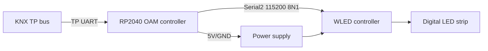

# OAM Digital LED Controller Hardware Bring-Up Guide

Until hardware is available, use CI, OpenKNXproducer, and the `test/` simulations for software validation. When the hardware is available, follow this sequence for bring-up.

## Wiring



| Function | RP2040 GPIO/interface | Connected device |
|---|---:|---|
| KNX TP TX | GPIO 0 / UART0 TX | KNX TP transceiver TX |
| KNX TP RX | GPIO 1 / UART0 RX | KNX TP transceiver RX |
| WLED TX | GPIO 4 / Serial2 TX | WLED UART RX |
| WLED RX | GPIO 5 / Serial2 RX | WLED UART TX |
| Programming LED | GPIO 2 | On-board status LED, active high |
| Programming button | GPIO 7 | Falling-edge input |
| Save interrupt | GPIO 6 | OpenKNX save signal |
| Ground | GND | Common ground for KNX transceiver and WLED |

WLED serial settings: `115200 baud, 8 data bits, no parity, 1 stop bit`. JSON frames use `CR/LF` termination.

## Flashing

```powershell
pio run -e develop_OAM_DigitalLEDController
pio run -e develop_OAM_DigitalLEDController -t upload
```

Do not upload until the target port and hardware connections have been confirmed. For a Release build:

```powershell
pio run -e release_OAM_DigitalLEDController
```

The UF2 file is located at `.pio/build/<environment>/firmware.uf2`.

## First-boot checklist

- [ ] KNX TP transceiver power, logic levels, and common ground are correct.
- [ ] WLED TX/RX are crossed correctly; do not connect 5 V directly to an RP2040 GPIO.
- [ ] The WLED firmware has its JSON serial interface enabled.
- [ ] The serial stream shows a `{"v":true}` state request after boot.
- [ ] WLED state replies update brightness, RGB, Preset, and nightlight feedback in KNX.
- [ ] The ETS application downloads successfully and its parameters match the startup defaults.
- [ ] The watchdog and programming LED do not indicate repeated resets.

## KNX Group Address test table

| Test | Object number | DPT | Expected behavior |
|---|---:|---|---|
| Switch | 201 | 1.001 | Sends WLED `on` |
| Relative dimming | 202 | 3.007 | Changes brightness by direction and step |
| Absolute brightness | 203 | 5.001 | Sends `bri`; feedback object 205 updates |
| Switch status | 204 | 1.001 | Mirrors WLED `state.on` |
| Scene | 206 | 18.001 | Maps KNX scenes 0..63 to WLED Presets 1..64 |
| RGB | 214 | 232.600 | Sends RGB and updates objects 209/211/213/215 |
| Nightlight | 216 | 1.001 | Sends `nl` using ETS duration/mode/target brightness |
| Preset | 218 | 5.001 | Selects WLED Preset 1..250 |
| Palette | 220 | 5.001 | Sets the WLED segment palette |
| Effect | 222 | 5.001 | Sets the WLED segment effect |
| Effect speed | 224 | 5.001 | Sets WLED `sx` |
| Effect intensity | 226 | 5.001 | Sets WLED `ix` |
| Segment switch / brightness | 254 / 256 | 1.001 / 5.001 | Targets the ETS-configured WLED segment ID |
| Segment reverse / mirror / freeze / select | 258 / 260 / 262 / 264 | 1.001 | Controls WLED `rev`, `mi`, `frz`, and `sel` |
| Transition | 266 | 7.002 | Sets the WLED transition time; subsequent commands send `tt` |
| UDP sync | 268 / 270 / 272 / 274 | 1.001 / 5.010 | Controls send/receive and their group bitfields |
| Live override / main segment | 276 / 278 | 5.010 | Controls WLED `lor` and `mainseg` |
| Playlist next / status | 280 / 281 | 1.001 / 5.010 | Advances the active playlist and reports `pl` |
| State request / reboot | 282 / 283 | 1.001 | Sends `v` or `rb` when a `true` telegram is received |
| Effect custom sliders / options | 284–295 | 5.010 / 1.001 | Controls effect-dependent `c1..c3` and `o1..o3` |
| Segment layout | 296–305 | 7.001 / 5.010 / 8.001 | Controls `start`, `stop`, `grp`, `spc`, and `of` |
| Secondary / tertiary RGBW | 306–309 | 251.600 | Controls WLED color slots `col[1]` and `col[2]` |
| Playlist save / start | 310 / 311 | 1.001 | Saves the ETS five-entry playlist and starts its configured Preset slot |
| Preset management | 312–318 | 1.001 / 5.010 | Arms, saves, deletes, cycles, or randomly selects Presets |
| Realtime control / status | 319–322 | 1.001 / 5.010 / 16.000 | Controls `live` and reports realtime source information |
| Health and capabilities | 323–332 | Multiple | Reports Wi-Fi, uptime, heap, error, build, effect/palette counts, segments and version |
| LED map / timebase | 333–335 | 5.010 / 12.001 | Selects `ledmap` and sends effect `tb` |
| Nightlight runtime | 336–342 | 5.010 / 8.001 | Sets duration, mode and target; reports values and remaining seconds (`-1` inactive) |
| Segment management | 343–349 | 16.000 / 1.001 | Sets/reports the configured segment name, reports presence, applies geometry, and arms/deletes |
| Playlist/Preset runtime | 350–352 | 1.001 | Stops a Playlist by selecting the configured non-Playlist Preset and reports active states |
| UDP node count | 353 | 8.001 | Reports `info.ndc`; `-1` means node-list collection is disabled |
| LED current | 354–355 | 7.001 | Reports estimated current and configured maximum current in mA |
| Network | 356–358 | 12.001 / 16.000 / 5.010 | Reports packed IPv4, separator-free BSSID and Wi-Fi channel |
| LED/matrix info | 359–362 | 7.001 | Reports LED count, actual FPS and optional matrix width/height |
| WLED time | 363–365 | 12.001 / 11.001 / 10.001 | Writes Unix epoch seconds and reports WLED local date/time |
| Additional segments 1–3 | 366–383 | Multiple, bidirectional | Controls three ETS-configured segment IDs with on, brightness, CCT, RGBW, options and name |
| 2D matrix segment | 384–391 | 7.001 / 1.001 / 5.010 | Controls `startY`, `stopY`, `rY`, `mY`, `tp`, `set`, `si` and `m12` |
| Filesystem / maps | 392–395 | 12.001 / 7.001 | Reports used/total decimal kB, Preset modification epoch and `info.maps` array length |
| Realtime source | 396–397 | 12.001 / 8.001 | Reports packed `info.lip` and WebSocket client count (`-1` means build-disabled) |
| Communication health | 398–402 | Multiple | Reports online state, response age, malformed JSON, oversized frames and UART overruns |
| Current alarm | 403–405 | 5.001 / 1.001 | Reports estimated current utilization, warning threshold and over-limit state |
| LED capabilities | 406–409 | 1.001 | Reports RGBW, manual white, CCT and active matrix capabilities |

For objects 370, 376 and 382, options bits are: bit 0 selected, bit 1 reverse,
bit 2 mirror, bit 3 freeze and feedback-only bit 7 segment present. Configure
all four segment IDs uniquely. Matrix Y fields are present only in compatible
WLED 2D builds; `set` and `si` accept 0..3, while `m12` accepts 0..7.

The online state is refreshed only by a fully valid WLED state frame. Timeout
zero disables offline timeout after the first valid reply. Current alarm values
are based on WLED's 16-bit estimated current and are not measurements or safety
cutoffs.

Segment deletion must be enabled in ETS, armed through object 346 and triggered
through object 348. The arm status is object 347 and clears after one command
or 30 seconds. Object 349 applies the current start/stop/grouping/spacing/offset
and name as one command; it rejects `stop <= start`.

WLED does not provide connected SSID, current Preset name, Playlist item or
progress, timer status, measured watts, or per-node online state through the
serial state/info response, so no misleading feedback objects are created.

Run the hardware-free validation first:

```powershell
python -m unittest discover -s test -p "test_*.py" -v
```

Then perform the tests in the table on the KNX bus.
