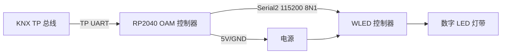

# OAM Digital LED Controller 硬件联调手册

当前没有硬件时，使用 CI、OpenKNXproducer 和 `test/` 仿真测试完成软件验证。硬件到位后按以下顺序联调。

## 接线



| 功能 | RP2040 GPIO/接口 | 连接对象 |
|---|---:|---|
| KNX TP TX | GPIO 0 / UART0 TX | KNX TP 收发器 TX |
| KNX TP RX | GPIO 1 / UART0 RX | KNX TP 收发器 RX |
| WLED TX | GPIO 4 / Serial2 TX | WLED UART RX |
| WLED RX | GPIO 5 / Serial2 RX | WLED UART TX |
| 编程 LED | GPIO 2 | 板载状态 LED，高电平点亮 |
| 编程按键 | GPIO 7 | 按下产生下降沿 |
| 保存中断 | GPIO 6 | OpenKNX 保存信号 |
| 地 | GND | KNX 收发器/WLED 共地 |

WLED 串口参数：`115200 baud, 8 data bits, no parity, 1 stop bit`。收发 JSON 帧以 `CR/LF` 结束。

## 烧录

```powershell
pio run -e develop_OAM_DigitalLEDController
pio run -e develop_OAM_DigitalLEDController -t upload
```

不要在未确认端口和硬件连接前执行上传。Release 构建：

```powershell
pio run -e release_OAM_DigitalLEDController
```

UF2 文件位于 `.pio/build/<environment>/firmware.uf2`。

## 首次启动检查清单

- [ ] KNX TP 收发器供电、电平和共地正确。
- [ ] WLED TX/RX 交叉连接，未把 5V 直接接到 RP2040 GPIO。
- [ ] WLED 固件启用 JSON 串口接口。
- [ ] 启动后串口能看到 `{"v":true}` 状态请求。
- [ ] WLED 返回状态后，亮度、RGB、Preset 和夜灯反馈进入 KNX。
- [ ] ETS 应用成功下载，参数值与启动默认值一致。
- [ ] 看门狗/编程 LED 无异常循环重启。

## KNX Group Address 测试表

| 测试 | 对象号 | DPT | 期望行为 |
|---|---:|---|---|
| 开关 | 201 | 1.001 | 发送 WLED `on` |
| 相对调光 | 202 | 3.007 | 按方向/步长改变亮度 |
| 绝对亮度 | 203 | 5.001 | 发送 `bri`，反馈对象 205 更新 |
| 开关状态 | 204 | 1.001 | 返回 WLED `state.on` |
| 场景 | 206 | 18.001 | KNX 场景 0..63 映射 WLED Preset 1..64 |
| RGB | 214 | 232.600 | 发送三通道颜色并同步 209/211/213/215 |
| 夜灯 | 216 | 1.001 | 使用 ETS 时长/模式/目标亮度发送 `nl` |
| Preset | 218 | 5.001 | 选择 WLED Preset 1..250 |
| Palette | 220 | 5.001 | 设置 WLED segment palette |
| Effect | 222 | 5.001 | 设置 WLED segment effect |
| Effect Speed | 224 | 5.001 | 设置 WLED `sx` |
| Effect Intensity | 226 | 5.001 | 设置 WLED `ix` |
| Segment 开关 / 亮度 | 254 / 256 | 1.001 / 5.001 | 控制 ETS 参数选择的 WLED Segment ID |
| Segment 反向 / 镜像 / 冻结 / 选择 | 258 / 260 / 262 / 264 | 1.001 | 控制 WLED `rev`、`mi`、`frz`、`sel` |
| 过渡时间 | 266 | 7.002 | 设置 WLED 过渡时间，后续命令携带 `tt` |
| UDP Sync | 268 / 270 / 272 / 274 | 1.001 / 5.010 | 控制发送、接收及组位图 |
| Live Override / 主 Segment | 276 / 278 | 5.010 | 控制 WLED `lor` 和 `mainseg` |
| Playlist 下一项 / 状态 | 280 / 281 | 1.001 / 5.010 | 推进当前 Playlist 并返回 `pl` |
| 状态请求 / 重启 | 282 / 283 | 1.001 | 收到 `true` 后发送 `v` 或 `rb` |
| Effect 自定义参数 / 选项 | 284–295 | 5.010 / 1.001 | 控制与 Effect 相关的 `c1..c3` 和 `o1..o3` |
| Segment 布局 | 296–305 | 7.001 / 5.010 / 8.001 | 控制 `start`、`stop`、`grp`、`spc`、`of` |
| 第二 / 第三 RGBW 颜色 | 306–309 | 251.600 | 控制 WLED `col[1]` 和 `col[2]` |
| Playlist 保存 / 启动 | 310 / 311 | 1.001 | 保存 ETS 五项 Playlist 并启动配置的 Preset 槽 |
| Preset 管理 | 312–318 | 1.001 / 5.010 | 解锁、保存、删除、循环或随机选择 Preset |
| Realtime 控制 / 状态 | 319–322 | 1.001 / 5.010 / 16.000 | 控制 `live` 并返回 Realtime 来源信息 |
| 健康与能力状态 | 323–332 | 多种 | 返回 Wi-Fi、运行时间、内存、错误、Build、Effect/Palette 数量、Segment 和版本 |
| LED Map / Timebase | 333–335 | 5.010 / 12.001 | 选择 `ledmap` 并发送 Effect `tb` |
| 夜灯运行参数 | 336–342 | 5.010 / 8.001 | 设置时长、模式和目标亮度，反馈参数与剩余秒数（`-1` 表示未运行） |
| Segment 管理 | 343–349 | 16.000 / 1.001 | 设置/反馈名称、反馈是否存在、统一应用布局，并提供受保护删除 |
| Playlist/Preset 运行状态 | 350–352 | 1.001 | 通过配置的非 Playlist Preset 停止 Playlist，并反馈活动状态 |
| UDP 节点数量 | 353 | 8.001 | 返回 `info.ndc`；`-1` 表示 WLED 未启用节点列表收集 |
| LED 电流 | 354–355 | 7.001 | 返回估算电流和配置的最大电流，单位 mA |
| 网络信息 | 356–358 | 12.001 / 16.000 / 5.010 | 返回打包 IPv4、无分隔符 BSSID 和 Wi-Fi 信道 |
| LED/矩阵信息 | 359–362 | 7.001 | 返回 LED 数量、实际 FPS，以及可选矩阵宽度/高度 |
| WLED 时间 | 363–365 | 12.001 / 11.001 / 10.001 | 写入 Unix 秒时间戳并返回 WLED 本地日期/时间 |
| 附加 Segment 1–3 | 366–383 | 多种，双向 | 控制三个 ETS Segment ID 的开关、亮度、CCT、RGBW、选项和名称 |
| 2D Matrix Segment | 384–391 | 7.001 / 1.001 / 5.010 | 控制 `startY`、`stopY`、`rY`、`mY`、`tp`、`set`、`si` 和 `m12` |
| 文件系统 / LED Map | 392–395 | 12.001 / 7.001 | 返回已用/总十进制 kB、Preset 修改时间和 `info.maps` 数组长度 |
| Realtime 来源 | 396–397 | 12.001 / 8.001 | 返回打包后的 `info.lip` 和 WebSocket 客户端数（`-1` 表示编译禁用） |
| 通信健康 | 398–402 | 多种 | 返回在线状态、回复时间、JSON 错误、超长帧和 UART 溢出计数 |
| 电流告警 | 403–405 | 5.001 / 1.001 | 返回估算电流占比、阈值警告和超过上限状态 |
| LED 能力 | 406–409 | 1.001 | 返回 RGBW、手动白光、CCT 和当前 Matrix 能力 |

对象 370、376 和 382 的选项位定义为：bit 0 选择、bit 1 反向、
bit 2 镜像、bit 3 冻结，反馈专用 bit 7 表示该 Segment 存在。四个
Segment ID 必须互不重复。Matrix Y 字段只在兼容的 WLED 2D 构建中
出现；`set` 和 `si` 范围为 0..3，`m12` 范围为 0..7。

只有完整且有效的 WLED state 帧才会刷新在线状态。超时参数为 0 时，
在首次有效回复后不再因超时离线。电流告警使用 WLED 16 位估算电流，
不是实测值，也不是安全断电机制。

Segment 删除必须先在 ETS 启用，通过对象 346 解锁，再由对象 348
触发。对象 347 返回解锁状态；执行一次删除或等待 30 秒后自动解除。
对象 349 将当前 start/stop/grouping/spacing/offset 和名称作为单条命令
应用；`stop <= start` 时拒绝发送。

WLED 串口 state/info 回复不包含当前连接 SSID、当前 Preset 名称、
Playlist 当前项目/进度、定时器状态、实测功率或单节点在线状态，因此
没有为这些字段制造不可靠的反馈对象。

先使用 `python -m unittest discover -s test -p "test_*.py" -v` 完成无硬件验证，再进行这张表的总线实测。
